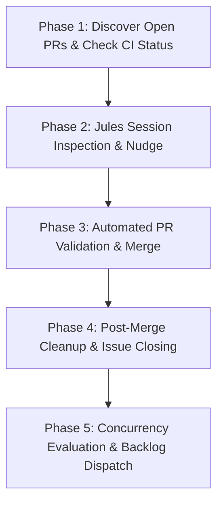

# Autonomous Multi-Repo Triage Runbook

## Overview

This document specifies the exact operational protocol executed by the autonomous triage loop across the S5 remote server stack (`arii/remote-server`, `arii/tech-dancer`, and `arii/boomtick`). It serves as both an operational guide and the technical specification for automating this workflow as a background daemon or scheduled service.

---

## 1. Environment & Multi-Repo Scope

The triage process monitors three tightly coupled repositories hosted on the S5 terminal container:
- **`arii/remote-server`**: `/srv/remote-server`
- **`arii/tech-dancer`**: `/srv/repos/tech-dancer`
- **`arii/boomtick`**: `/srv/repos/boomtick`

### Authentication & Secrets
- **GitHub CLI (`gh`)**: Authenticated as `arii` via `GH_TOKEN` with `repo`, `admin:public_key`, `gist`, and `read:org` scopes.
- **Jules API**: Authenticated via `JULES_API_KEY` (stored in `/srv/remote-server/.env`).

---

## 2. The 20-Minute Triage Cycle

Every 20 minutes (or on event trigger), the triage pipeline executes five sequential phases:



---

### Phase 1: Pull Request Discovery & CI Status Evaluation

1. **List open pull requests across all 3 repositories**:
   ```bash
   gh pr list -R arii/remote-server --state open
   gh pr list -R arii/tech-dancer --state open
   gh pr list -R arii/boomtick --state open
   ```

2. **Evaluate CI rollup and mergeability for each PR**:
   ```bash
   gh pr view <pr_number> -R <repo> --json title,state,mergeable,statusCheckRollup,isDraft,files
   ```
   - **Mergeability Check**: Must report `"mergeable": "MERGEABLE"`. If `"CONFLICTING"`, flag for rebase/conflict resolution.
   - **CI Status Check Rollup**: Inspect all completed check runs and statuses:
     - 0 failing (`conclusion != "FAILURE"` and `conclusion != "TIMED_OUT"`).
     - 0 pending (`status != "IN_PROGRESS"` and `status != "QUEUED"`).
     - Allow `"SKIPPED"` or `"NEUTRAL"` conclusions for conditional workflow steps (e.g., path filters).
   - **Empty PR Detection**: If `files` array length is 0:
     - Inspect whether the associated Jules session generated zero diffs.
     - If empty due to an error, comment feedback to the session or close the PR and issue.

---

### Phase 2: Jules Session Inspection & Proactive Nudging

1. **Fetch active sessions from Jules API**:
   ```bash
   GET https://jules.googleapis.com/v1alpha/sessions?pageSize=10
   Header: x-goog-api-key: $JULES_API_KEY
   ```

2. **Handle session states**:
   - **`AWAITING_USER_FEEDBACK` (Stall Prevention)**:
     - Jules enters this state when it generates an execution plan (`planGenerated`) or asks a clarifying design question before touching files.
     - Fetch session activities:
       ```bash
       GET https://jules.googleapis.com/v1alpha/sessions/<session_id>/activities
       ```
     - If the agent has proposed a plan or is awaiting approval, evaluate the plan against issue scope and send approval:
       ```bash
       POST https://jules.googleapis.com/v1alpha/sessions/<session_id>:sendMessage
       Content-Type: application/json
       Payload: {"prompt": "Plan looks great! Please proceed with implementation, verify syntax, ensure unit tests pass, and submit the pull request."}
       ```
     - This unblocks the session, moving it back to `IN_PROGRESS`.

   - **`IN_PROGRESS`**:
     - Allow the session to continue running.

   - **CI Failure Feedback (`td agent run-feedback-check`)**:
     - Execute the daemon check inside the container:
       ```bash
       docker exec -i remote-terminal-1 bash -c '
         set -a; [ -f /srv/remote-server/.env ] && . /srv/remote-server/.env; set +a;
         if [ -n "$JULES_API_KEY" ]; then
           cd /srv/repos/tech-dancer && td --json agent run-feedback-check;
         fi
       '
       ```
     - `JulesFeedbackDaemon` matches sessions to PRs, parses check run logs for failures, and feeds the error trace back to Jules so it can repair its own broken tests.

---

### Phase 3: Automated PR Validation & Merge

Once a PR satisfies all safety gates:
1. All CI checks completed and succeeded.
2. `mergeable == MERGEABLE`.
3. If marked as draft, promote to ready:
   ```bash
   gh pr ready <pr_number> -R <repo>
   ```
4. Merge using squash or standard merge with automatic branch deletion:
   ```bash
   gh pr merge <pr_number> -R <repo> --merge --delete-branch
   ```

#### Handling Merge Conflicts
Proven agent flow (used for remote-server #148 → #149); prefer over manual:
1. Create an isolated repair worktree via BoomTick MCP (`repo_create_repair_branch`), then verify it is on the PR head SHA — never assume the base.
2. Run the resolver: `deep-agent/.venv/bin/python deep-agent/resolve_conflicts.py <worktree-path>` (merges base, resolves on real disk, verifies zero markers).
3. Human review: confirm marker-free (`git diff --check`), read every resolved hunk, sanity-check (py_compile/lint for code).
4. Commit via `repo_commit_patch` (exact file allowlist), open a draft replacement PR (`open_replacement_pr`, pushMode) linking the original, comment the pointer on the original.
5. Manual fallback (rebase + hand resolve + force-with-lease) only if the agent flow fails twice.

---

### Phase 4: Post-Merge Cleanup & Issue Deduplication

1. **Verify Linked Issues**:
   - If the PR body did not include `Fixes #<issue>` or if the issue remains open, close it with a clear attribution:
     ```bash
     gh issue close <issue_number> -R <repo> --comment "Resolved by PR #<pr_number>"
     ```
2. **Prune Stale CI Failure Issues**:
   - Automated CI monitors frequently open `fix(ci): CI failure for PR #<n>` issues.
   - Query open issues with label `ci-failure`:
     ```bash
     gh issue list -R <repo> --label ci-failure --state open
     ```
   - If the referenced PR has already merged cleanly, close the orphan failure issue immediately.
3. **Prune Duplicate Issues**:
   - Scan open issues for overlapping scope or duplicate tasks and close the superseded issue referencing the canonical issue.

---

### Phase 5: Backlog Dispatching

When all currently active PRs and Jules sessions have completed:
1. Check current concurrency: count active Jules sessions (`state in ["IN_PROGRESS", "AWAITING_USER_FEEDBACK"]`).
2. If concurrency is below the configured ceiling (typically 1 or 2 concurrent sessions):
   - Query prioritized open backlog issues lacking the `jules` label:
     ```bash
     gh issue list -R arii/remote-server --state open --json number,title,labels
     ```
   - Exclude meta-issues (e.g. burn-down epics or decommission trackers).
   - Label candidate issue with `jules` to trigger session dispatch:
     ```bash
     gh issue edit <issue_number> -R arii/remote-server --add-label jules
     ```

---

## 3. Automation Architecture Recommendation

To run this pipeline without manual agent intervention:
1. **Extend `JulesFeedbackDaemon` in `arii/boomtick` (`cli/dev_tools/daemon.py`)**:
   - Add `_check_and_approve_plans(session)` to handle `AWAITING_USER_FEEDBACK`.
   - Add `_check_and_merge_approved_prs()` using GitHub GraphQL / REST check rollups.
   - Add `_dispatch_backlog_issues()` with concurrency throttling.
2. **Deployment**:
   - Run as a systemd user service on the S5 host, or a lightweight scheduled cron in `remote-terminal-1`:
     ```cron
     */20 * * * * cd /srv/repos/tech-dancer && td agent run-triage >> /var/log/triage-daemon.log 2>&1
     ```
