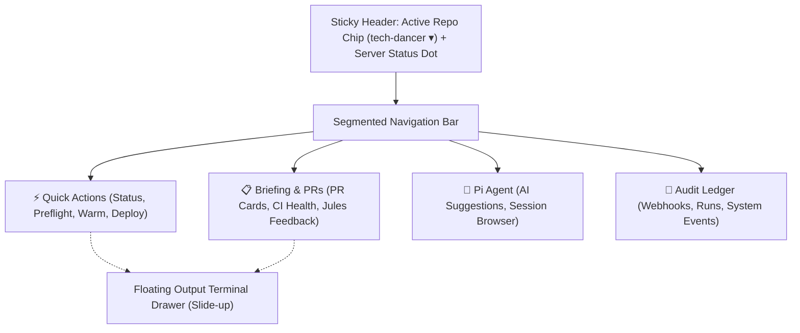

# S5 Buttons: UX Evaluation & Enhancement Guide

An in-depth user experience (UX) and interface (UI) evaluation of **S5 Buttons** (`https://dev-onasafari.ddns.net:8443/buttons`), benchmarked against the design patterns of **RepoAuditor AI** (`https://repo-auditor-ai.vercel.app/`).

---

## 1. Executive Summary & Core Diagnosis

**S5 Buttons** was designed as an operational command deck for a Trigkey S5 home server to execute frequent developer operations (`td`, `docker compose`, `jules`, `preflight`) without typing on a mobile keyboard.

While its **underlying infrastructure is powerful, deterministic, and safe** (server-side rendering, allowlisted command dispatch, PTY streaming, OAuth gate), its **front-end presentation currently suffers from raw utility / wireframe syndrome**:
- **Monolithic Single-Column Feed:** All features (stack controls, repo actions, PR briefings, Pi suggestions, ledger audit logs, Agent sessions) are stacked in a single vertical scroll.
- **Visual Monotony:** Full-width gray rectangular buttons with centered, unformatted text lack visual weight distinction (safe read actions look identical to container-recreating actions).
- **Mobile Ergonomics Friction:** The terminal output pane sits below the buttons, forcing constant scrolling; blocking native `window.confirm()` modals disrupt flow; and unformatted text dumps (such as Dependabot runs with 30+ package names) blow out vertical height.
- **Fragile State Feedback:** Repos returning unexpected responses or timeouts produce raw client-side JavaScript crashes (e.g. `SyntaxError: Failed to execute 'json' on 'Response'`).

In contrast, **RepoAuditor AI** demonstrates a modern, cohesive DevAI dashboard standard: structured dark navy palettes, persistent navigation, visual chips/badges for diffs and PR statuses, dedicated primary/secondary button hierarchies, and compartmentalized workflow cards.

---

## 2. Comparative Analysis: S5 Buttons vs. RepoAuditor AI

| UX Dimension | S5 Buttons (`dev-onasafari.ddns.net:8443`) | RepoAuditor AI (`repo-auditor-ai.vercel.app`) | Key Takeaway / Lesson |
| :--- | :--- | :--- | :--- |
| **Information Architecture** | Flat, infinite single-page scroll with 7+ stacked sections. | Compartmentalized multi-view console (Sidebar navigation: Overview, PRs, Workflow Health, Jules Management). | Separate stack administration from repo-level code review and triage. |
| **Color & Theme** | High-contrast stark black (`#111` / `#000`) with monotone gray borders (`#555`). | Polished DevAI dark theme (`#0B1120`, `#1E293B`, glowing cyan/blue accents). | Adopt semantic color tokens (emerald for health, amber for warnings/sync, sapphire for AI). |
| **Repo Scoping** | Disconnected top repo cards vs. middle dropdown picker; unclear which buttons apply to which repo. | Global persistent "Active Repo" chip (`arii/glossy`) visible in the sidebar/header. | Make the selected repository a sticky global header context. |
| **PR & Issue Cards** | Plain text string blobs (`branch — CI: failing — merge: clean — updated...`) with raw buttons. | Scannable cards with badge chips (`#164`, `branch`, file counts, `+4 -4` green/red diffs). | Decompose metadata into scannable visual chips and tags. |
| **Action Hierarchy** | Every button is a full-width gray slab; subtitle text is cramped below centered headings. | Distinct primary actions (blue filled button with icon) vs secondary outline/ghost actions. | Differentiate high-risk operations (Deploy/Recreate) from safe read-only queries (Briefing/Status). |
| **Error Handling & Logs** | Full terminal dump in a `<pre>` element or raw string exceptions. | Dedicated status widgets, dismissible alert toasts, and clean collapsible log drawers. | Surface root-cause summary badges; keep raw logs in an on-demand slide-over drawer. |

---

## 3. Detailed UX Findings & Pain Points

### A. Information Architecture & Layout
1. **Scope Ambiguity:**
   - The top section lists `arii/boomtick`, `arii/remote-server`, and `arii/tech-dancer` as cards with text saying *"Pick it in the Briefing picker"*.
   - Below the Server buttons sits a second dropdown: `Repo for the buttons and briefing below:`.
   - On mobile, when scrolled down, the user loses track of which repo is currently targeted by repo-scoped actions (`Preflight check`, `Warm repo context`, `Briefing`).
2. **Monolithic Vertical Stacking:**
   - On a phone viewport, the page requires excessive scrolling to reach the **Ledger** or **Agent Sessions**.
   - Important actions and output logs compete for the same cramped vertical space.

### B. Visual Design & Button Ergonomics
1. **Centered Text Inside Slabs:**
   - Buttons like `Repo briefing (td, fast)` contain multi-line descriptions centered inside the button. Centered multi-line text reduces reading speed.
   - All buttons have identical sizing and gray borders, giving equal visual importance to `Preflight check` (safe read-only) and `Deploy buttons` (kills and rebuilds the serving container).
2. **Text Dumps in Failing Runs:**
   - Live testing revealed that a failing Dependabot run dumps an unbroken string of dozens of npm packages (`@grpc/grpc-js, @hono/node-server, @modelcontextprotocol/sdk...`) stretching across many lines with no formatting or collapse toggle.

### C. Feedback & Error Resilience
1. **Raw JavaScript Crashes on Network Glitches:**
   - In `refreshBriefing()`:
     ```javascript
     const r = await fetch("/buttons/api/briefing?repo=" + encodeURIComponent(repo));
     if (!r.ok) { briefingErrEl.textContent = "briefing unavailable: " + (await r.json()).error; }
     ```
   - When switching to `boomtick` during live evaluation, the endpoint returned an empty or non-JSON response. Calling `.json()` without a catch resulted in:
     `briefing unavailable: SyntaxError: Failed to execute 'json' on 'Response': Unexpected end of JSON input`.
   - The UI displayed this raw exception directly to the user.
2. **Blocking Native `window.confirm()` Modals:**
   - Every action with confirmation triggers a browser modal. On mobile devices, browser confirm dialogs are jarring, block the JavaScript thread, and cannot carry formatted metadata or warning icons.
3. **Hidden Output Pane:**
   - The output pane (`<pre id="out">`) sits below the action buttons. When tapping a button at the top of the screen, the user cannot see streaming progress without scrolling down.

---

## 4. Actionable Redesign Blueprint

### Blueprint 1: Mobile App Shell with Bottom Tabs
Instead of a single infinite page, organize the mobile experience into 4 focused tabs or a segmented control:



### Blueprint 2: Transformed PR Cards (RepoAuditor AI Style)
Transform raw text paragraphs into structured, scannable cards:

#### Current Markup:
```text
#164 Fix deployment failed due to wasm size limit on Cloudflare Pages
fix-wasm-deployment-error — CI: failing (Lighthouse) — merge: clean — updated 2h ago
[Fix CI with Jules]
```

#### Proposed Card Layout:
- **Header Row:** PR `#164` badge + Status indicator (Red dot for failing CI, Green dot for passing).
- **Title:** Clear bold title linked directly to GitHub.
- **Branch & Metadata Chips:**
  - Branch tag chip: `fix-wasm-deployment-error`
  - Diff badge: `+4` / `-4` (green / red)
  - Time chip: `2h ago`
- **Action Strip:**
  - Primary button: `✨ Fix CI with Jules` (Blue accent)
  - Secondary button: `Update Branch` (Ghost outline)

---

## 5. Implementation Recommendations & Code Snippets

### A. Robust Client-Side API Handling (`buttons/server.py`)
Fix the unhandled JSON parsing exception and provide graceful error banners:

```javascript
// Replace fragile r.json() calls with safe parsing
async function fetchSafeJson(url, options = {}) {
  try {
    const res = await fetch(url, options);
    const text = await res.text();
    let data = null;
    try {
      data = JSON.parse(text);
    } catch {
      data = { error: text || `HTTP ${res.status}` };
    }
    return { ok: res.ok, status: res.status, data };
  } catch (err) {
    return { ok: false, status: 0, data: { error: err.message || "Network error" } };
  }
}

// Updated refreshBriefing using fetchSafeJson:
async function refreshBriefing() {
  const picker = document.getElementById("briefingRepo");
  const repo = picker ? picker.value : "tech-dancer";
  briefingEl.innerHTML = '<span class="spinner"></span> Loading live briefing…';
  briefingErrEl.textContent = "";

  const { ok, data } = await fetchSafeJson("/buttons/api/briefing?repo=" + encodeURIComponent(repo));
  if (!ok) {
    briefingEl.textContent = "";
    briefingErrEl.innerHTML = `
      <div class="alert-box">
        <strong>Briefing unavailable for ${escHtml(repo)}</strong>: ${escHtml(data.error || "Unknown error")}
        <button class="retry-btn" onclick="refreshBriefing()">Retry</button>
      </div>`;
    return;
  }
  renderBriefing(data);
}
```

### B. Dependabot Failing Runs Formatter
Prevent Dependabot package lists from blowing out layout height by collapsing package names into an expandable chip:

```javascript
function formatFailingRun(run) {
  let text = `${run.name} on ${run.branch} (${run.event})`;
  if (!run.failed || !run.failed.length) return text;

  // Detect long Dependabot package enumerations
  return run.failed.map(f => {
    let jobTitle = f.job;
    if (f.steps && f.steps.length) {
      jobTitle += ` (${f.steps.join(", ")})`;
    }
    // Truncate long package strings
    if (jobTitle.length > 90) {
      const match = jobTitle.match(/for (@?[^,]+, @?[^,]+)/);
      if (match) {
        return `${match[1]} <span class="chip-more">+more packages</span>`;
      }
    }
    return jobTitle;
  }).join("; ");
}
```

### C. Visual Styles Upgrade (Dark Navy Palette & Button Hierarchy)
Upgrade the styles in `buttons/server.py` to match modern DevAI ergonomics:

```css
:root {
  --bg-app: #0b1120;
  --bg-card: #131d31;
  --bg-card-hover: #1e293b;
  --border: #24344d;
  --text-main: #f1f5f9;
  --text-muted: #94a3b8;
  --primary: #3b82f6;
  --primary-hover: #2563eb;
  --danger: #ef4444;
  --danger-bg: #450a0a;
  --warning: #f59e0b;
  --success: #10b981;
}

body {
  background: var(--bg-app);
  color: var(--text-main);
  font-family: -apple-system, BlinkMacSystemFont, "Segoe UI", Roboto, sans-serif;
  margin: 0;
  padding: 12px 16px 80px; /* Space for bottom dock */
}

/* Modern Left-Aligned Card Buttons with Clear Hierarchy */
.btn-tile {
  display: flex;
  flex-direction: column;
  align-items: flex-start;
  text-align: left;
  background: var(--bg-card);
  border: 1px solid var(--border);
  border-radius: 10px;
  padding: 12px 14px;
  margin: 8px 0;
  cursor: pointer;
  transition: all 0.15s ease;
}

.btn-tile:hover {
  background: var(--bg-card-hover);
  border-color: #3b82f6;
}

.btn-tile .blabel {
  font-weight: 600;
  font-size: 1.05em;
  color: #fff;
}

.btn-tile .bsub {
  font-size: 0.82em;
  color: var(--text-muted);
  margin-top: 4px;
  line-height: 1.3;
}

/* Critical Action Highlight (Deploy / Recreate) */
.btn-tile.danger-action {
  border-left: 4px solid var(--warning);
}

/* Slide-up Floating Output Drawer for Mobile */
#outputDrawer {
  position: fixed;
  bottom: 0;
  left: 0;
  right: 0;
  background: #050811;
  border-top: 1px solid var(--border);
  box-shadow: 0 -4px 16px rgba(0,0,0,0.6);
  z-index: 1000;
  transition: transform 0.25s ease-out;
}
```

---

## 6. Implementation Roadmap

1. **Step 1: Resilience & Text Cleanup (Immediate)**
   - Apply `fetchSafeJson()` to eliminate `SyntaxError` crashes on repo change.
   - Format and truncate Dependabot failing run strings.
   - Extract top error messages into the status banner so mobile users don't need to scroll to the end of raw output.

2. **Step 2: Button & Card Restyling (Low effort)**
   - Left-align button text and add subtle icon/accent badges.
   - Style PR items as structured cards with badges for PR number, branch, and diff stats.
   - Add visual differentiation between safe read-only commands and system-recreating commands.

3. **Step 3: Layout & Mobile View Restructuring (Medium effort)**
   - Introduce a sticky top bar with active repository switcher.
   - Add a segmented control or tab system (`Actions` | `Briefing` | `Pi` | `Ledger`).
   - Implement an expandable bottom drawer for the terminal output so it stays accessible across all views.

   ### Why BoomTick / The Session Failed

The issue is not that the `boomtick` MCP server crashed or failed to boot; rather, **the model entered a hallucination and tool-calling loop** due to missing agent instructions, improper tool selection, and misconfiguration:

1. **`boomtick` MCP is actually alive and registering resources:**
* When asked `are contexts warm`, Pi called `list_mcp_resources` and `boomtick` returned six active resources (`mcp://workspace/agent-contract`, `mcp://git/changed-files`, `mcp://ci/latest-run`, etc.).


2. **Wrong tool called for reading resources (`list_mcp_resources` instead of `read_mcp_resource`):**
* When the user asked to `"read the agent contractrs"`, the assistant called `list_mcp_resources server="mcp"` (hallucinating an MCP server named `"mcp"`).


* After seeing `"MCP server 'mcp' has no resources. Servers with resources: boomtick"`, it called `list_mcp_resources server="boomtick"` instead of using the proper read tool: `read_mcp_resource(server="boomtick", uri="mcp://workspace/agent-contract")`.


* It retrieved the resource metadata a second time and simply dumped the resource catalog list again, asking if the user wanted it to read it, without ever fetching the file contents.


3. **Small local model context confusion (`qwen3`):**
* As visible in the bottom-right status bar of the terminal screenshot, the active session is running **`qwen3`** (a local quantized model) with an empty or non-instructive system prompt.


* When the user typed `init`, the model latched onto an internal token (`"init /think"`) and guessed actions like `jules_create_session` or `github_create_issue` because it lacked deterministic workspace guidance on what `init` means.


---

### How to Improve Your Pi Configuration

In `remote-server`, Pi config templates reside in `terminal/pi-config/` (such as `APPEND_SYSTEM.md`, `mcp.json`, `models.json`, and `settings.json`) and populate `~/.pi/agent/` inside the container.

#### 1. Fix MCP Tool Usage in `APPEND_SYSTEM.md`

Add explicit MCP navigation instructions to `terminal/pi-config/APPEND_SYSTEM.md` (and inside `/root/.pi/agent/APPEND_SYSTEM.md` in the running container):

```markdown
# Agent Instructions & Tool Policy

## MCP Resource & Tool Discipline
- The BoomTick MCP server is registered under the server name `boomtick`.
- To inspect resource catalog: use `list_mcp_resources(server="boomtick")`.
- To read resource contents (such as Agent Contracts or CI status): ALWAYS use `read_mcp_resource` with `server: "boomtick"` and the resource `uri` (e.g. `mcp://workspace/agent-contract`).
- NEVER call `list_mcp_resources` when asked to read or view a resource.
- NEVER invent server names like `mcp`.

## Project Workflows
- When the user says `init`: verify git status, check warm contexts using `list_mcp_resources`, and summarize the active repository branch and recent CI state.

```

#### 2. Verify `mcp.json` Server Configuration

Ensure your `terminal/pi-config/mcp.json` cleanly isolates `boomtick` without naming aliases:

```json
{
  "mcpServers": {
    "boomtick": {
      "command": "node",
      "args": ["/srv/boomtick/mcp/dist/index.js"],
      "env": {
        "NODE_ENV": "production"
      }
    }
  }
}

```

#### 3. Update Model Settings & Temperature in `models.json` / `settings.json`

Local models like `qwen3` can get caught in conversational re-prompting loops when tool schemas are dense:

* **Lower Temperature:** Set temperature to `0.0` or `0.1` in `settings.json` for deterministic tool routing.
* **Enable Thought Truncation:** Ensure `/think` tags or internal scratchpad outputs are parsed properly so the model does not treat thought commands as user inputs.


* **Alternative Routing:** For heavy multi-turn agent contracts and multi-resource triage, route the default agent model to a larger or frontier model if network permits, or supply a specialized system brief in `agent-brief.md`.


#### 4. Reload Config Inside the Active Pi Session

After editing the files in `~/.pi/agent/`, apply the changes in your Pi terminal without restarting:

* Run `/reload` to reload prompt files, skills, and MCP tools.


* Test with an explicit command:
```text
read mcp://workspace/agent-contract from boomtick

```

### 1. Further UX Recommendations for S5 Buttons

Based on your live interface (`S5 buttons` running on `remote-server`) and the existing audit:

```
+-----------------------------------------------------------------------------------+
|  ⚡ S5 Command Deck                                 [ Active: arii/boomtick ▾ ]   |
|  [● tech-dancer: up-to-date]  [● remote-server: up-to-date]  [● boomtick: pulled] |
+-----------------------------------------------------------------------------------+
|  [  Quick Actions  ]  |  [  Briefing & PRs  ]  |  [  Pi Agent  ]  |  [  Ledger  ]  |
+-----------------------------------------------------------------------------------+

```

#### A. Unified Global Context & Top Navigation

* **Promote Active Repo to a Sticky Header:** As seen in your screenshots, repo cards sit at the very top, while the dropdown picker (`Repo for the buttons and briefing below: boomtick`) is buried below the server buttons. Make the active repo a sticky header chip with a dropdown so context is never lost when scrolling.


* **Convert the Single-Page Scroll into Segmented Views:** You currently stack **Server Actions**, **Briefing**, **Pi Suggestions**, **Agent Sessions**, and **Ledger** in a single vertical column. Keep the 4 tabs (`⚡ Actions`, `📋 Briefing`, `🤖 Pi Agent`, `📜 Ledger`) permanently mounted at the top or bottom as a sticky segmented bar rather than an in-page scroll anchor.


#### B. Visual Hierarchy & Critical-Path Ergonomics

* **Differentiate Dangerous Actions from Safe Telemetry:**
* **Critical/Rebuilding Actions:** `Deploy buttons (rebuilds this page)` and `Recreate terminal` drop connections and restart containers. Style these with an amber/red left border accent or outline to distinguish them from standard actions.


* **Routine Queries:** `Preflight check`, `Warm repo context`, and `Status` should use subtle neutral/slate card tiles.


* **Left-Align Multi-Line Button Text:** Buttons currently center both title and description text (e.g., `Deploy buttons (rebuild this page)` and `Pull + rebuild this page (drops ~30s)`). Centering slows down scanning; left-aligning the title with a smaller secondary caption underneath improves readability.


#### C. Card Modernization in Briefings & Suggestions

* **Restructure PR & Check Tiles:** The briefing card displays raw unformatted text:
```text
#1011 chore: release main
release-please--branches--main  CI: passing  merge: clean  2026-10-29
Reviews: @boomtick[bot] COMMENTED

```


Decompose this into scannable UI components:
* Top bar: `#1011` badge, PR link, relative timestamp (`2h ago`).
* Middle row: Branch chip (`release-please--branches--main`), status pills (Green: `CI Passing`, Green: `Merge Clean`).
* Action row: Direct `Merge (squash)` button and inline review verdict.


* **Truncate Long Error Strings & Collapsible Logs:** Under `Failing runs`, strings like `Issue Operations on main (issues) — failed: Validate Issue Quality...` wrap across multiple lines. Wrap failure details inside an expandable toggle to keep card heights uniform.


#### D. Persistent Slide-Up Output Drawer

* The terminal execution output sits at the absolute bottom of the DOM (`Output: running: briefing-td ...`). When an action is tapped near the top, the screen appears unresponsive unless scrolled down. Replace the static bottom `<pre>` with an expandable slide-up drawer or bottom sheet that pops up with streaming status while running, showing exit codes with a `Dismiss` button.


---

### 2. Instructions for the `arii/boomtick` Repository

Now that `boomtick` is a decoupled, standalone container action (`ghcr.io/arii/boomtick-review`) and pure Node MCP server, apply these instructions directly within `arii/boomtick`:

#### A. Modernize MCP Tool Output & Resources (`mcp/`)

1. **Adopt Typed `outputSchema` and `structuredContent`:**
* In `mcp/src/tools/` (e.g., `github.get_merge_conflict_files.ts`, `repo.run_tests.ts`), replace raw Markdown string arrays inside `{ type: "text", text }` with structured JSON payloads matching explicit Zod/JSON schemas.


* This enables external agents (Claude, Cursor, Jules, Pi) to parse outputs deterministically without relying on fragile regex.


2. **Expose Repository State via MCP Resources:**
* Instead of forcing agents to run tool-execution turns to inspect context, expose slow-changing or static data via MCP Resources:


* `mcp://workspace/agent-contract` (reads `.agents/AGENT_CONTRACT.md`)


* `mcp://git/changed-files` (returns modified files)


* `mcp://ci/latest-run` (exposes recent CI exit statuses)


#### B. Review Action Hardening (`ghcr.io/arii/boomtick-review`)

1. **Emit Native GitHub `suggestion` Blocks:**
* In `lib/buildCodeReviewPrompt.ts`, instruct the Gemini prompt to output valid Markdown code suggestion blocks:
```markdown
```suggestion
const cleanPath = path.normalize(rawPath);
```

```


* Update the review runner (`scripts/impact-ai-code-review.ts` / Octokit client) to post these directly on diff line ranges so PR authors can accept suggestions with a single click in GitHub's web UI.


2. **AST-Aware Diff Filtering & Token Budgeting:**
* In `lib/codeReviewUtils.ts`, add a pre-flight filter that automatically removes minified builds, lockfiles (`pnpm-lock.yaml`, `package-lock.json`), and binary/SVG assets from the prompt payload to eliminate context overflow on large PRs.


#### C. Deterministic Workstation CLI (`cli/` - `td`)

1. **Tree-Sitter Anti-Slop & Design Token Checks:**
* Keep `td` strictly Python/AST-based without embedding LLM clients.


* Equip `td audit` with AST checkers (e.g., `tree-sitter-typescript`) to flag:
* Raw layout elements (`<div style="...">`) that bypass approved design tokens.


* Unapproved `@ts-ignore` / `@ts-expect-error` additions.


* Unused AI placeholder stubs or empty scaffolding comments.


2. **Unified Preflight Command (`td preflight`):**
* Package local checks into one deterministic offline command:


```bash
td preflight

```


This should sequentially run type validation, in-memory merge conflict simulations (`git merge-tree origin/main`), and open PR branch overlap scans.


#### D. Release Automation (`.release-please-manifest.json`)

* Configure component-based versioning in `release-please-config.json` so that changes bump and release the decoupled artifacts independently:


1. Container Image: `ghcr.io/arii/boomtick-review:<tag>`


2. Pure-Node MCP Package: `@arii/boomtick-mcp`


3. Python CLI Package: `boomtick-cli` (delivering `td`)
